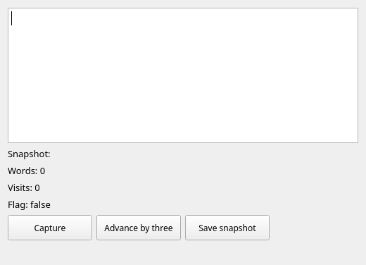

# Construction from behaviour contracts

Implemented in the upgrade copy on 2026-11-11; updated on 2026-11-12 after
[request grounding and executable repairs](REQUEST_REPAIR.md). The report linked
there covers the unchanged six-request English trial and its independent checks.

The original calculator extension had a family-specific schema and a hand-written controller recipe. It demonstrated calculator variants, not general program construction. The new path accepts typed state, observable views and required action outcomes. It does not select an implementation from the program's name.

Five compositions pass in both Python and C++, including one with a label and equation coefficients chosen at benchmark run time. An editor also passes in both languages using the same primitive components. The original calculator and stream-utility interfaces remain compatible.

## Use the shared path

~~~sh
cd /home/whisper/repo-work/unllm-upgrade
./build/unllm --code python 'Make a basic text editor.'
./build/unllm --code python 'Build an app with a text area, a counter, and uppercase and save buttons.'
./build/unllm --code cpp 'Build an app that increases a counter by 7.'
./build/unllm --code cpp --spec examples/upgrade/behaviours/mixed_workspace/specification.json
~~~

The English front end still has a bounded concept vocabulary. It links domain nouns and action labels to ERG-readable surfaces, retains the original concepts/spans, and grounds typed frames from ACE/ERG arguments, compounds and conjunctions. Targets, unit direction and numeric operands use semantic roles. Unsupported content and ambiguous targets reject. Known concepts ground reusable requirements; they do not select app controllers. Detailed or unsupported English descriptions may need an explicit specification.

In schema 2, the program field is an arbitrary label. Changing it does not change the plan or constructed handler graph. For example:

~~~json
{
  "schema": 2,
  "program": "any_label_you_choose",
  "title": "My workspace",
  "state": {
    "quantity": {"type": "number", "initial": 0},
    "notes": {"type": "text", "initial": ""}
  },
  "views": [
    {"id": "quantity_input", "kind": "number_input", "state": "quantity"},
    {"id": "notes_input", "kind": "text_edit", "state": "notes"},
    {"id": "word_count", "kind": "label", "value": "words(notes)"}
  ],
  "actions": [
    {"id": "solve", "label": "Update", "ensure": "2 * next.quantity == prev.quantity + 6"},
    {"id": "capitalize", "assign": {"notes": "upper(strip(notes))"}},
    {"id": "store", "label": "Save notes", "effect": "save", "state": "notes"}
  ]
}
~~~

The solver must construct an update satisfying the relation, rather than being handed an increment function. Multiple next-state constraints can be solved together. They commit simultaneously; states absent from the next-state constraints retain their previous values.

Revisions use the existing protocol. Replace actions, views or state definitions through `:revise {...}`, then use `:code cpp` to switch backends. Each revision reconstructs and revalidates the program.

## What changed

The [specification](../synthesis/behaviour/spec.py) describes number/text/Boolean state, flat typed record collections, editable text or numeric inputs, list views, derived labels, actions and periodic events. Scalar transition actions declare relational postconditions over prev and next states. Assignment outcomes compose typed expressions. Effect outcomes request file/edit operations, record insertion/removal/update or monotonic clock operations on bound typed state. Optional Boolean preconditions reject an action before it changes state.

The [planner](../synthesis/behaviour/planner.py) presents primitive contracts to the existing native SWI-Prolog provider search. It checks recursive dependencies, availability and target-language support, then checks typed state/event wiring through Soufflé. The independent proof checker validates those witnesses. Effect goals are resolved through an unordered operator prerequisite graph, rather than preselected procedure lists. Saving, for example, requires encoding, a path, successful atomic writing, path bookkeeping and a saved snapshot. The constructor consumes the resulting plan; missing prerequisites reject.

The [solver](../synthesis/behaviour/solver.py) uses cvc5 SyGuS to synthesize complete scalar update expressions from relational postconditions. Its bounded grammar includes arithmetic through polynomial degree two, comparisons, Boolean conditions and conditional expressions. Goal-derived products are permitted productions; the full relation must still hold. This covers coupled updates, inverse equations and variable percentages. Supported numeric guards restrict solver obligations; other guard forms retain the stronger unconditional scalar obligation and execute as runtime checks. No program-specific controller is selected.

The [constructor](../synthesis/behaviour/construct.py) binds the selected contracts to state fields and builds a shared handler graph. [Both backends](../synthesis/behaviour/emit.py) lower that graph structurally. Python is parsed, compiled and emitted through the AST tooling. C++ is formatted and compiled with Clang. Generated applications contain their runtime helpers and explicit action methods; they do not run a specification interpreter or call unllm at application runtime.

Reusable runtime components provide the Qt widgets, text/record operations, strict JSON persistence, monotonic clocks and timers, UTF-8 I/O, atomic saves, history, dirty tracking and dialogs. They contain no application-family dispatch. The Python and C++ applications use the same specification and selected contracts. Numeric refresh preserves partial keyboard entry; tests now type through Qt instead of setting values directly.

The old calculator schema is a compatibility capability for bare expression-calculator goals after semantic grounding. There is no early calculator-name branch intercepting richer requests. Its successful tests remain evidence about that existing controller.

## Evaluation

The final CTest run passes **12/12 suites**, with 208.54 seconds summed test time. The six upgrade suites contain **64 Python tests**, alongside the six original regression suites. The actual CLI's twelve unchanged-request outputs and their independent interaction checks also pass; see [the repair report](REQUEST_REPAIR.md).

The development matrix passes **10/10 outputs**, five in each language:

| Composition | Python executable checks | C++ executable checks |
| --- | ---: | ---: |
| Editable text, derived counts, composed transformations, open/save | 12 | 24 |
| Temperature relation and a guarded derived expression | 25 | 50 |
| Coupled state swaps/transfers and a conditional clamp | 69 | 138 |
| Text, Boolean state, numeric transitions and persistence together | 28 | 56 |
| New label and equation coefficients chosen at run time | 27 | 54 |

These counts cover ordinary validation. Each output additionally passes fresh cases after construction. C++ runs normal and address/undefined-behavior sanitizer executables, doubling its checks.

The median resident-Engine generation time was **1.161 seconds for Python** and **30.417 seconds for C++**. Generation includes validation; C++ compiles the application and two test executables. The five Python measurements range from 0.812 to 1.591 seconds and C++ from 29.732 to 33.258 seconds on this run. Other regression work overlapped part of the run; these are observed timings, not a controlled speed comparison with the earlier milestone.

Additional tests establish that:

- Changing an arbitrary program label leaves both the component plan and handler graph unchanged.
- Missing primitive dependencies reject construction.
- Impossible mathematical postconditions reject synthesis.
- Unknown effects, unsafe expression syntax, unbound states and transition goals beyond the degree-two grammar reject clearly.
- Fresh coupled updates use the old state for every assignment.
- English features compose into mixed requirements.
- An editor survives a UTF-8/emoji save/reopen cycle, undo/redo, cut/paste and cancellation of unsaved changes.
- Requirement revisions synthesize and revalidate a new transition.

The independent executable checker interprets the specification with a small whitelisted AST/tree evaluator, uses Hypothesis-generated state inputs and drives actual Qt widgets. Arithmetic conditionals short-circuit, numeric limits are checked, and label observations are compared with independent reference semantics. Normal applications use Qt dialogs; the external harness supplies dialog decisions through the same service boundary to exercise cancellation, errors and file effects deterministically.

Execution is isolated with bubblewrap: no network or home/source-tree access, a read-only job and runtimes, and a separate writable output directory. Compiler commands, diagnostics, solver solutions, component witnesses, source hashes and screenshots remain in each artifact report.

Raw reports are [the composition matrix](../.benchmarks/behaviours.json) and [the actual CLI request](../.benchmarks/behaviour_cli.json). The CLI request combined a text area, counter, uppercase action and saving with the model disabled. Its status was validated and its construction report records application_name_used=false.

The [latest regression summary](../.benchmarks/request_fix_regression.json) records the suite totals. The development fixture SHA-256 is `8c73cb67ac14dc01cfaae7a51c2f8cb516f7912d03753628186b86bffd6f87d0`. The run-time-selected relation was `3 * next.quantity == prev.quantity + 15`; its full specification and fresh inputs are preserved in the matrix report and exported example.

This is development evaluation, not a blinded test or evidence of unrestricted programming ability. The existing sealed question sets were not read. The runtime-chosen composition checks that construction accepts new labels, constants and combinations within its declared fragment.

## Run the generated examples

~~~sh
./examples/upgrade/behaviours/run.sh text_workbench python
./examples/upgrade/behaviours/run.sh conversion cpp
./examples/upgrade/behaviours/run.sh paired_state python
./examples/upgrade/behaviours/run.sh mixed_workspace cpp
./examples/upgrade/behaviours/run.sh new_requirements python
~~~

See [the examples and manifest](../examples/upgrade/behaviours/README.md). The example folders are outputs and are never consulted during construction.

## Bounds

Removing application categories does not make synthesis unrestricted. The current shared path supports its declared state types, widget primitives, text/record operations, file and clock effects, periodic events and bounded degree-two polynomial-real transition grammar. It does not yet infer arbitrary algorithms, discover new APIs, synthesize unrestricted loops or understand arbitrary English. Unsupported requirements still need a new primitive, a richer representation or a clearer specification. They do not need a new registered application family.

Scalar solver obligations concern mathematical reals. Executable binary64 values and intermediate results must remain finite within ±10^15. Finite tests cover the implemented behavior; the provider proofs and solver results are not a proof of every GUI sequence or floating-point input.

UTF-8 input/output is limited to 4 MiB. Saves replace files atomically after a successful write. Cancelled path selection and failed I/O do not replace the edited contents; successful saves record a new saved snapshot. Persisted text and record states require an explicit decision before discarding pending changes. Records are flat with at most 10,000 items and 16 scalar fields. Other limits are 32 state fields, 48 views, 48 actions, eight periodic events, 192 validation scenarios and a 180-second synthesis budget, with the native planner's dependency limits also applying.

The generated main sources include reusable runtime helpers; their size is reported, not forced to a 100-line target. More behavior now comes from composed contracts and synthesized transitions, rather than an expanding list of whole-program recipes.

## Reproduce

~~~sh
python3 tools/setup_upgrade.py --check
cmake -S . -B build -DUNLLM_SYMBOLIC=ON
ctest --test-dir build --output-on-failure
.venv/bin/python tools/benchmark_behaviours.py
.venv/bin/python tools/export_behaviour_examples.py
~~~

No new dependency was required beyond the pinned upgrade and Qt toolchain. Changes are confined to the upgrade copy.

The [latest isolation audit](../.benchmarks/request_fix_isolation.json) found no changed original tracked files or diff, and no unexpected changes to pre-existing edits preserved in the upgrade copy.
