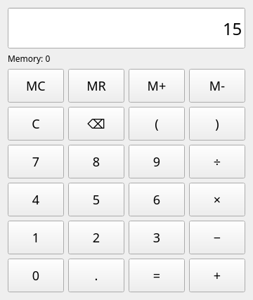

# Stateful calculator application upgrade

Implemented and measured on 2026-11-11 in `/home/whisper/repo-work/unllm-upgrade`.

This report describes the original calculator-specific extension. Its controller recipe did not establish general application construction. The later [behaviour-contract path](BEHAVIOUR_CONSTRUCTION.md) removes application-name restrictions from the shared constructor and adds new composition tests. This calculator interface remains compatible.

unllm can now generate working desktop calculators in Python/PySide6 and C++/Qt6. The default application supports the four arithmetic operations, decimals, unary signs, algebraic precedence, parentheses, clear, backspace and keyboard input. Optional memory adds M+, M-, MR and MC. Requirements can restrict operations, remove controls, disable keyboard input, change display precision and set the window title.

All ten CTest suites pass. Four application specifications pass in both languages, including separate GUI actions chosen after construction. The initial utility/reasoning milestone is documented in [UPGRADE_REPORT.md](UPGRADE_REPORT.md).

## Generate and run

~~~sh
cd /home/whisper/repo-work/unllm-upgrade
./build/unllm --code python 'Make a standard calculator app.'
./build/unllm --code cpp 'Create a calculator with memory buttons.'
./build/unllm --code python 'Make a calculator that supports only addition and subtraction.'
./build/unllm --code cpp --spec examples/upgrade/calculator/memory.spec.json
~~~

The response supplies the generated source, artifact report and exact run command. In an interactive conversation, `:revise {"memory":true,"operations":["add","subtract"]}` regenerates and revalidates the application; `:code cpp` switches its backend.

Runnable exported examples are included:

~~~sh
./examples/upgrade/calculator/run-python.sh
./examples/upgrade/calculator/run-python.sh memory
./examples/upgrade/calculator/run-cpp.sh
./examples/upgrade/calculator/run-cpp.sh memory
~~~

The launchers require a desktop display. The C++ launcher uses a local executable cache and can rebuild it from the exported source. Python uses the checkout's virtual environment. The [example manifest](../examples/upgrade/calculator/manifest.json) records hashes, dependencies and validation jobs. The examples are outputs; generation never reads them as a catalog of answers.

## How construction works

1. ACE/ERG analyzes the English request into MRS semantics. The application interpreter reads concepts, arguments, conjunctions and negative scope. Supported requirements become a checked application specification. Unrepresented properties, such as scientific functions or a blue display, return unsupported. Explicit JSON is available when the supported English fragment cannot express a requirement reliably.
2. SWI-Prolog recursively expands requested capabilities into available components for the selected language. Requirements such as parsing, evaluation, state, event dispatch and rendering become dependency trees. Soufflé supplies component wiring compatibility. Independent checks validate the selected providers, dependency witnesses and wires.
3. A typed application representation describes state fields, named function arguments, expressions, branches, exception handling, widgets and event bindings. Controller construction combines expression, state and widget components according to the specification. Type checks reject incompatible assignments and calls before emission.
4. cvc5 SyGuS constructs small rules used by the emitted application: the nonzero divisor guard and, when requested, two-argument memory updates. These obligations concern mathematical reals. cvc5 does not synthesize an unrestricted GUI or prove its complete behavior.
5. Python is emitted through Python ASTs; C++ is emitted by structured traversal and formatted with clang-format. Both use parsers generated from the same ANTLR grammar. Reusable Qt adapters connect the emitted event handlers to actual displays and buttons.
6. Independent arithmetic cases and Qt Test mouse/keyboard events run against the generated application. C++ runs normal and address/undefined-behavior sanitizer builds. Failed candidates retain a failed status and diagnostic report.

There is no generative model on this path, no Python eval, and no regex grammar for arithmetic. The real ANTLR grammar defines precedence, unary signs, parentheses and decimal literals. The validation oracle uses Python's tokenizer and a whitelisted AST evaluator independently of that grammar.

The main new sources are [the typed representation](../synthesis/apps/ir.py), [planner](../synthesis/apps/planner.py), [controller construction](../synthesis/apps/construct.py), [grammar](../synthesis/apps/Arithmetic.g4), [backends](../synthesis/apps/emit.py) and [validation worker](../synthesis/apps/validate.py). The recursive native planner is in [Prolog](../reasoning/prolog/rules.pl) and [the C++ bridge](../src/logic_bridge.cpp).

## Validation and measured generation time

The final development matrix uses the following fixed requirements. Every job also receives a separate fresh GUI check after its ordinary validation.

| Application | Python checks | C++ checks | GUI scenarios per build | Python generation | C++ generation |
| --- | ---: | ---: | ---: | ---: | ---: |
| Standard | 101 | 202 | 15 | 1.112 s | 28.159 s |
| Memory controls | 104 | 208 | 18 | 1.908 s | 31.793 s |
| Addition/subtraction, six-digit display, changed title | 100 | 200 | 14 | 0.874 s | 27.692 s |
| Mouse only, multiplication/division, no parentheses/backspace | 90 | 180 | 4 | 1.030 s | 27.481 s |

Each build checks 86 distinct arithmetic inputs from fixed edge cases and 60 Hypothesis examples, with duplicates removed. Counts include successful expressions and required errors. C++ totals are doubled because both normal and sanitizer executables run. GUI checks cover actual controls, keyboard dispatch, precedence, result continuation, fresh input after equals, malformed expressions, division errors, recovery, leading zeros, input limits, memory accumulation and atomic memory overflow when applicable.

Median resident-Engine generation time was **1.071 seconds for Python** and **27.926 seconds for C++**. C++ jobs compile the application and two GUI test executables; compilation and sanitizer validation dominate this workload. These are generation times, not delays each time the calculator evaluates an expression.

The matrix also passes a three-turn conversation: English creation, a revision adding memory while restricting operations, and a switch to C++. Separate fresh GUI inputs include `46+19=65`, a memory subtraction giving `57`, and mouse-only `8×7=56`.

A fresh actual CLI request, `Create a calculator with memory buttons.`, returned a validated C++ application with `UNLLM_MODEL=off`. Its report records 86 arithmetic cases and 18 GUI scenarios in both builds, and about 30.7 seconds inside the Engine. This checks the complete CLI path in addition to direct Engine benchmarks.

The complete CTest run passes 10/10 suites: the six original suites plus upgrade, synthesis, upgrade_cli and app_synthesis. The four added suites contain 44 Python tests. Application tests additionally check unavailable providers, target-language isolation, invalid specifications, state type errors, changed requirements and an entity-name collision with the word Calculator.

The matrix is explicitly **development evaluation, not blinded evidence of general app generation**. It does not inspect the existing sealed question sets. Input hash:

~~~text
tests/upgrade_apps.json
499d3f091c3fef19ff31126d8f1cb70b269fd7ce682d5f554e53b5aef0d04f38
~~~

Raw local reports are [the matrix](../.benchmarks/applications.json), [fresh CLI](../.benchmarks/calculator_cli.json) and [isolation audit](../.benchmarks/calculator_isolation.json). These reports and generated job workspaces are ignored runtime artifacts. Exported source and validation summaries remain in the examples directory.

## Contracts and boundaries

Arithmetic uses binary64, with finite inputs, intermediate values and results bounded to ±10^15. Display precision is 3–15 significant digits; internal continuation retains 17 digits. Expressions are limited to 1,024 characters, 256 tokens, 32 parenthesis levels and 32 unary signs. Algebraic precedence determines evaluation. This is not a financial decimal calculator.

New digits after equals start another expression; an operator continues the result. Backspace after a result or error clears. Invalid input, disabled operations, division by zero and overflow display an error. Clear or a fresh number recovers. A rejected memory update leaves the stored value intact.

The standard main source is 247 meaningful lines in Python and 368 in C++; the memory versions are 277 and 405. Parser sources are additional generated dependency code. The implementation preserves the earlier goal of useful programs around 100 lines without padding or forcing a robust GUI into an artificial line limit.

The new representation and adapters provide a foundation for more stateful applications. Another application family still requires domain contracts, components and controller construction rules; the system does not yet generate arbitrary applications, scientific calculators or unrestricted GUI layouts. Passing finite tests is not a proof of every GUI sequence or floating-point behavior.

Candidate execution is isolated with bubblewrap, without network or writable checkout/home access. C++ sanitizer coverage includes emitted application code and generated parser code; the third-party static ANTLR runtime is not instrumented. The job budget remains 180 seconds.

## Dependencies and reproduction

ANTLR 4.13.2 tool/runtime archives are checksum locked in [dependencies-apps.lock.json](../dependencies-apps.lock.json). Both target parsers come from one grammar. The generated files have a checksum manifest. Python pins ANTLR runtime 4.13.2, PySide6 Essentials 6.12.0 and shiboken6 6.12.0. The tested host supplies Qt6 Widgets/Test 6.12.0, Clang/clang-format 23.1.1 and Java. The worker and generated Python GUI use Python 3.12.13.

~~~sh
python3 tools/setup_upgrade.py --check
cmake --build build --parallel 2
ctest --test-dir build --output-on-failure
.venv/bin/python tools/benchmark_apps.py
.venv/bin/python tools/export_app_examples.py
~~~

For a new checkout, install the documented host development dependencies, then run `python3 tools/setup_upgrade.py --build`. Setup builds the local ANTLR runtime and grammar artifacts without a root install; it does not install host Qt development packages.

The baseline hash audit found no changes to the original unllm directory's tracked files or diff, and no changes to pre-existing user edits carried into this copy outside the explicitly modified upgrade files. No original executable was replaced.
