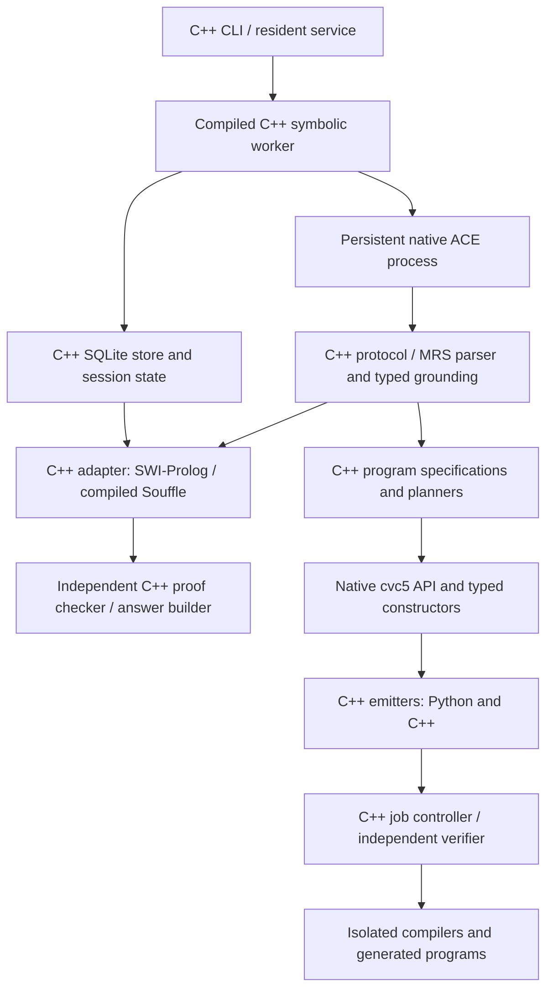

# Plan: migrate unllm's implementation to C++

Proposed 2026-11-12; review completed 2026-11-13. Implementation started on
2026-11-13 in the isolated `build-cpp` tree. The existing product has not been
replaced. See [implementation evidence](CPP_MIGRATION_PROGRESS.md) for completed
checks and remaining gates. This plan takes precedence over earlier Python-worker
architecture choices and precedes symbolic distillation or broader coding features.

## Objective and boundaries

Implement unllm's first-party production engine and supported product commands in
C++. Remove Python from interpretation, knowledge access, inference orchestration,
proof checking, answer composition, program construction, code emission and job
validation orchestration. Preserve the useful behavior already demonstrated.

Work only in `/home/whisper/repo-work/unllm-upgrade`. Preserve the original sibling
checkout, ActivityScope's copy, carried user edits, installed commands and live data.
Use a separate `build-cpp` directory and isolated migration state until promotion.

This is a migration, not a new general-purpose synthesis architecture. Keep the
existing stream, calculator-compatibility and shared-behavior capabilities. Do not
add task-specific handlers, broaden the solver language or begin the distillation
pilot to compensate for porting failures. Record necessary correctness repairs
separately from language translation.

### What “C++ implementation” means

| Area | Final requirement |
| --- | --- |
| Engine, CLI, worker and public maintenance commands | First-party implementation in C++; no Python helper, interpreter embedding, transpiled Python runtime or hidden Python service. |
| Native dependencies | ACE/ERG, SWI-Prolog, compiled Soufflé, cvc5, SQLite, ANTLR and Qt remain dependencies. Their upstream implementation languages are distinct from unllm's own code. |
| Declarative knowledge | Existing Prolog/Datalog rules, grammars and JSON data remain explicit artifacts, as previously selected. A C++ port does not mean translating every rule into imperative C++. |
| Output languages | Continue generating Python and C++; both emitters are written in C++. |
| Generated Python support | Python libraries, runtime helpers and GUI probes may exist as target-program resources. They are executed only inside a requested Python program's execution/validation environment, never to implement the host engine. |
| Build and release checks | First-party setup/orchestration uses CMake and C++ tools. Native release tests do not require Python. Optional Python-output tests use an explicitly declared target interpreter. |
| Existing experiments and historical tests | Preserve as development evidence, outside the installed product and default dependency graph. They cannot become runtime fallbacks. New host-side migration tools/tests are C++. |
| Offline teacher work | Deferred. Future distillation uses the migrated C++ representation and verification interfaces; model calls remain offline and outside the runtime. |

The intended claim is precise: factual answers, maintenance, C++ generation and
validation, and Python source emission work without Python installed. Executing a
generated Python application still requires Python. No interpreter can be hidden
inside a native launcher to satisfy the gate.

## Current dependency audit

The C++ entry point launches `.venv/bin/python -u tools/symbolic_worker.py` in
[src/symbolic.cpp](../src/symbolic.cpp). That worker constructs the Python `Engine`.
Native reasoning is real, but Python owns substantial surrounding application logic.

| Current implementation | C++ destination / responsibility |
| --- | --- |
| `tools/symbolic_worker.py` | Compiled worker: request protocol, statuses, deadlines, diagnostics. |
| `upgrade/model.py` | Typed claims, relations, goals, meanings, validation, Unicode keys and stable identities. |
| `upgrade/store.py`, `importers.py`, `tools/unllm_facts.py` | SQLite transactions, snapshots, source imports, aliases, validity, preparation and a native facts command. |
| `upgrade/semantics.py`, `linking.py`, `synthesis/behaviour/lexicon.py` | Persistent ACE supervision, structured MRS decoding, entity/domain linking, spans and semantic translation. |
| `upgrade/native.py` | Direct native reasoning adapter; eliminate ctypes and wheel-relative library discovery. |
| `upgrade/proof.py` | Separate C++ proof verifier, including a restricted parser for witness data. |
| `upgrade/engine.py` | Sessions, assertions/corrections/undo, hypotheses, reference resolution, answers and dispatch. |
| `synthesis/spec.py`, `language.py`, `catalog.py`, `solver.py`, `backends/` | Stream specification, grounding, planning, native synthesis and both emitters. |
| `synthesis/apps/` | Calculator specification, typed control-flow representation, constructor, solver and emitters. |
| `synthesis/behaviour/` | Shared behavior specification, grounding, expressions, effect contracts, planner, handler construction and emitters. |
| `upgrade/synthesis.py`, build/validation modules | Native job coordinator, artifact management, independent outcome checks, compiler/process execution and bounded repair. |
| `tools/unllm_update.py` and its invoked tools | Native maintenance pipeline for the existing public `unllm update` command, including ingest/evaluation dependencies. |
| Setup/export/benchmark scripts used by release workflows | CMake/C++ replacements; original scripts retained only as isolated references until their replacements pass. |

The audit must follow subprocesses, not only imports. The existing update command
launches Python directly from [tools/unllm_main.cpp](../tools/unllm_main.cpp), and
its script invokes ingest and evaluation tools. Porting the symbolic worker alone
would leave a product-level dependency.

Inventory supported build/engine profiles explicitly: symbolic, legacy, shadow,
and each enabled search configuration. Include public diagnostic commands and
their optional dependencies. The final dependency gate applies to every declared
supported profile, not only the default symbolic path. Existing optional model
integrations are recorded as such; this port does not add them to the symbolic path.

Also inventory the existing optional first-party Rust search bridge under
`search/`. It is not introduced by this upgrade, but cannot be silently included
in a claim that all first-party production code is C++. Record its shipped search
contract in milestone M0. If retained in the supported release profile, replace
its first-party implementation with a C++ search adapter/backend and migrate or
rebuild its indexes reversibly. The existing SQLite FTS path is a candidate basis,
not assumed to be equivalent to Tantivy ranking or indexing. Disabling a supported
search mode is a capability reduction, not successful migration. Do not modify
the original checkout's bridge or live indexes.

## Target architecture

Retain the `Symbolic::ask` boundary initially. Replace the Python child with a
compiled `unllm_symbolic_worker`; keep its process isolation, hard deadlines and
restart behavior. The CLI still speaks a versioned structured protocol. A worker
process written in C++ meets the requirement; moving everything into one process
is unnecessary for this migration.

The current native bridge has process-global SWI/Soufflé state. Use one owning
execution thread per worker initially, preserve serialized behavior and isolate
world/session state. Do not introduce a thread pool or shared SWI engines during
the port. Reuse `src/logic_bridge.cpp`, with an explicit C++ ownership interface
and RAII cleanup, rather than replacing the reasoning engines.

Use a shared C++ process supervisor for ACE, compilers, sandboxed targets and the
worker. Preserve argument-vector execution, bounded I/O, simultaneous stdout/stderr
draining, close-on-exec descriptors, process groups, cancellation and child reaping.
No shell-built command strings for user text. Respect the current effective parser,
solver, answer and build deadlines; record progress/deadline transitions explicitly.

## Technical decisions

### 1. Typed data, Unicode and compatibility

Create native types for the existing schemas instead of carrying every operation
as unchecked JSON. JSON remains an external interchange format. Reuse the existing
json-c wrapper where appropriate, adding strict type/range/unknown-field checks.
Preserve null versus absent, integer versus Boolean, finite-number restrictions,
depth limits and structured error/status distinctions.

Use a maintained native Unicode library, with ICU as the planned choice, for
normalization, case folding and code-point operations. Pin its Unicode behavior
against the current runtime. Python uses NFKC followed by case folding and Unicode
whitespace handling; ASCII lowercasing is not an equivalent port. Preserve linking
offsets through length-changing substitutions and distinguish bytes from code points.

Specify canonical JSON and SHA-256 input bytes explicitly. Use a native SHA-256
implementation through a maintained library, with OpenSSL EVP as the planned
provider. Freeze vectors for Unicode, ordering, numbers, negative zero and hashes.
Do not assume a C++ JSON serializer reproduces Python's number formatting.

Preserve durable claim/source IDs and existing SQLite schema where possible.
Version derived cache keys if serialization changes; rebuild caches without losing
source data. Any necessary database migration operates on a copy first, is
transactional and has a tested rollback. Never silently rewrite existing identities.

### 2. ACE and MRS without PyDelphin

Keep ACE 0.9.34 and ERG 2025 as the initial compatibility baseline. Replace
PyDelphin's process adapter and codecs, not the grammar. Implement a C++ client for
the pinned structured ACE protocol actually used today, including its TSDB response
envelope. Capture protocol transcripts before writing the replacement.

Use ANTLR's existing C++ target for restricted ACE-envelope/SimpleMRS grammars and
typed visitors. Preserve top/index, elementary predicates, labels, arguments,
quoted constants, variable properties, handle/individual constraints and links.
Handle notes, multiple analyses, completion, malformed output and EOF explicitly.
Do not parse semantic structures with sentence regexes or discard unsupported
content merely to obtain a result. See the [ACE options](https://delph-in.github.io/docs/tools/AceOptions/)
and [ANTLR C++ target](https://github.com/antlr/antlr4/blob/4.13.2/doc/cpp-target.md).

Maintain the current separate normal/code/fragment parser lifetimes and limits.
Compare decoded graphs against captured PyDelphin output before live integration.
Variable renaming may be normalized for comparison; scope, polarity and source
evidence cannot be erased. Preserve rejection diagnostics across alternatives.
The known cold/resident mixed-request discrepancy is a recorded issue to diagnose,
not a reason to ignore `loc_nonsp` or broaden parser budgets invisibly.

### 3. Store, native inference and independent proof verification

Port SQLite/WAL transactions, atomic source replacement, alias resolution,
half-open validity intervals, revisions and prepared-background caches. Keep a
consistent read snapshot for a factual request and release it before a long code
job. Preserve correction, undo, hypotheses, explicit completeness and context limits.

Call SWI-Prolog and generated Soufflé through the existing native boundary. Keep
rule ownership, input/derived tuple limits, proof depth and inference budgets.
Reuse native provenance output, but verify it with a separate C++ component before
answering. Port the checker's source/polarity/type/binding obligations independently
of the inference implementation. A successful native query is not its own proof.
Parse witness terms as restricted data; do not use a general source evaluator.

Preserve answer status, citations and factual content. Diagnostic ordering or
formatting may change only where it does not change the public contract. Report
worker/parser/solver failures distinctly from unsupported meaning or a false claim.

### 4. Native program models, expression parsing and cvc5

Port the three existing representations as separate C++ types: stream programs,
calculator applications and shared behavior specifications/handler graphs. Avoid
merging them into an ambitious new universal IR during a compatibility port.

Replace every `ast.parse` dependency with a bounded native requirement-expression
grammar and typed visitor. Reuse ANTLR's C++ runtime, with a grammar separate from
the existing calculator `Arithmetic.g4`. It must cover the currently supported
state references, Boolean expressions, comparisons, conditionals, literals and
primitive calls, retaining precedence, type checks and size limits. It is not an
arbitrary Python interpreter. Parse once into typed nodes, then use those nodes
for synthesis, emission and an independently implemented reference evaluator.

Obtain a pinned native cvc5 1.3.1 SDK with headers and libraries. The installed
Python wheel is not the final SDK or deployment location. Port all three solver
integrations, preserving grammar productions, constants, guards, simultaneous
updates, time budgets and solution decoding. Native API support exists in the
[1.3.1 C++ interface](https://cvc5.github.io/docs/cvc5-1.3.1/api/cpp/cpp.html).
Check term-manager ownership and lifetimes; solver objects/terms cannot outlive
their owners. Preserve the distinction between real-arithmetic proof and binary64
execution, including the existing evaluation-order repair path.

Port component metadata, provider selection, prerequisites and plan validation to
C++; retain native Prolog planning and Soufflé compatibility checks. Preserve
arbitrary supported state names and compositions without new app-name dispatch.

### 5. Both emitters are C++ code

Build Python and C++ source by traversing typed program structures. Python emission
needs explicit indentation, precedence, identifier validation and literal escaping;
it cannot invoke Python's AST unparser. C++ emission retains structured traversal,
Clang formatting/type checking and current runtime helpers. Formatting equality
with old source is not required; independently checked behavior is.

Move generated-program support into a clearly named resource tree. Python Qt
helpers and ANTLR Python output are target-language assets read/copied by C++, never
imported by the host. Likewise keep C++ Qt helpers as target resources. Preserve
source/resource hashes, manifests, run instructions, previews and relocatable
references. Do not embed complete fixture programs as generation templates.

Generate fixed ANTLR target parsers during resource/toolchain preparation where
possible. Record grammar/tool hashes; do not require a fresh Java invocation for
each user request. Java is a parser-generation build tool, not a host interpreter.

Expose source generation separately from execution/validation, with an explicit
emission-only mode. Without a Python target environment, Python source can still
be emitted; report validation unavailable/unperformed and never mark it validated.
Default requested validation must signal unsuccessful validation through the
structured status and exit contract. Do not install interpreters automatically.

### 6. Validation and maintenance also move to C++

The native job controller owns fixtures, deadlines, compilation, sandbox setup,
scenario generation, expected results, comparison and repair decisions. Replace
Hypothesis in required host workflows with deterministic C++ boundary/property
generators and recorded seeds; carry over discovered counterexamples. Keep the
old Hypothesis tests as optional development evidence until native coverage exists.

Reuse C++ Qt drivers. When testing a generated Python application, a minimal Python
target-side probe may drive its widgets and return observations; the C++ controller
supplies scenarios and judges results. It cannot delegate interpretation, synthesis
or expected-answer construction to that probe. No Python child is permitted for
a C++ target job or factual request.

Preserve independent oracles. Calculator expectations must not simply run the
same generated ANTLR evaluator as the candidate; use a separate reference evaluator,
fixed expected cases and arithmetic-tree tests. Require original-request checks
alongside specification-to-program checks. Verify the verifiers with corrupted
proofs/contracts and deliberately faulty generated behavior.

Port facts/import/update tools and every product command's transitive Python
dependency. Preserve update dry-run/check exit codes, staged rebuilds, verification,
atomic swaps, rollback and retention behavior. Exercise updates against local
fixtures and temporary pack directories; no large downloads or live pack changes
are needed to validate the port. Research/training scripts outside the supported
product may remain archived, clearly excluded from release dependencies.

## Milestones and order

Each milestone produces a reviewable artifact and a focused test report. Do not
delete its reference implementation until replacement behavior is demonstrated.
No milestone is complete merely because code compiles or file extensions changed.

| Milestone | Deliverable | Exit gate |
| --- | --- | --- |
| M0 — Freeze and inventory | Source/artifact hashes, capability and command inventory, dependency map, representative raw parser responses, DB copies, old statuses and independent expectations. | Every runtime/helper invocation classified; known failures and first-party Rust path explicit; original/user edits unchanged. |
| M1 — Native foundation and feasibility | Native SDK locks; C++ types/JSON/Unicode/hash/process utilities; small ACE/MRS and cvc5 integration probes; separate build/install profile. | Without Python: link native engines, decode representative MRS, synthesize a scalar update, supervise/reap children and pass identity vectors. No broad port before these dependencies work. |
| M2 — Data and factual reasoning | Native store/import core, reasoning adapter, independent proof checker, factual semantics, session/answer engine and compiled worker. | Factual requests, source evidence, contradictions, corrections, undo, hypotheses and context isolation pass through the actual CLI; forged proofs fail; snapshot/DB behavior preserved. |
| M3 — Program representations and grounding | Native stream/calculator/behavior schemas, expression parser/reference evaluator, program grounding and native plan/solver adapters. | Existing specs and captured language analyses yield equivalent typed requirements/plans or documented correctness repairs; negative cases remain explicit. |
| M4 — Generation in both languages | Stream constructors/emitters first, shared behavior next, calculator compatibility last; versioned target resources. | Both languages emit from unchanged supported specs; no Python host process; scalar repair, simultaneous updates and supported effect ordering preserved. |
| M5 — Native executable validation | C++ job controller, property cases, independent oracles, Qt workflows and sanitizer/bubblewrap integration. | Existing utility/app/behavior selections and all six original requests pass their independent workflows in both languages; failure paths remain failures. |
| M6 — Product tools and packaging | Native facts/import/update/ingest/evaluation paths, release tooling and any retained first-party search adapter; service fingerprints and installed resources. | Every supported shipped command works within its declared native/target-tool dependencies; updates/rollback tested on fixtures; installed tree works away from source checkout. |
| M7 — Cutover and removal | Native default, no production Python path or fallback, archived references, corrected docs and reproducible dependency audit. | Full compatibility report, no-Python deployment matrix, native release tests, process/linkage audit and performance gates pass. |

M2 and the synthesis work can progress independently after M1's shared types and
interfaces are stable. M6's maintenance inventory begins at M0 rather than being
discovered at the end. The critical risks are MRS compatibility, native dependency
packaging, expression/emitter semantics and preserving independent validation.
Give effort estimates after M1; the current audit does not justify a reliable date.

## Proposed code layout

These are planned module boundaries, not a demand for a file per trivial class.

| Location | Ownership |
| --- | --- |
| `include/unllm/symbolic/`, `src/symbolic/` | Types, canonical identities, process supervisor, ACE/MRS, linking, grounding, store, native reasoning, proof, sessions and answers. |
| `include/unllm/synthesis/`, `src/synthesis/` | Existing three program models, expression grammar adapter, planning, cvc5, constructors, both emitters and jobs. |
| `tools/unllm_symbolic_worker.cpp` | Compiled protocol endpoint. |
| Native facts/update/ingest/evaluation tool targets | Product maintenance and migration/release verification. |
| `grammars/` | Restricted MRS/protocol/requirement grammars; preserve calculator grammar identity. |
| `resources/generated_programs/{python,cpp}/` | Target helpers/probes and parser resources with manifests; not host modules. |
| `reasoning/prolog/`, `reasoning/souffle/`, `data/` | Existing explicit rules and domain knowledge. |
| `tests/cpp_migration/` | Native parity, independent behavior, malformed-input, process and deployment checks with fixtures. |
| `cmake/`, native dependency locks | Imported targets, resource preparation, packaging and explicit optional target toolchains. |

Update CMake source registration deliberately; the current `src/*.cpp` glob does
not recursively include the proposed modules. Prefer explicit source lists or
module targets. Retain the isolated C++17 boundary required by the pinned generated
Soufflé code; first-party host modules use C++20. Do not expose dependency ABI
details across public typed interfaces unnecessarily.

## Dependency and installation policy

Preserve pinned engine/grammar versions initially. Add native cvc5 headers/libraries
and the selected native Unicode/hash dependencies to a versioned lock with archive
hashes, licenses and runtime dependencies. Reuse SQLite/json-c, SWI, Soufflé, ANTLR
and Qt through explicit CMake targets. Avoid loading anything from `.venv` or a
developer's site-packages directory.

cvc5's [upstream build](https://github.com/cvc5/cvc5/blob/cvc5-1.3.1/INSTALL.rst)
uses Python build tooling. Keep that visible: obtain a verified native SDK artifact,
or build it in a separate dependency-builder environment and retain its recipe.
That upstream build dependency is not permitted in the installed unllm runtime.
The project configure/build/install gate uses staged native SDKs with Python absent;
do not falsely claim all upstream dependencies were built from source without it.

Remove mandatory `uv`, venv creation, PyDelphin, Python cvc5 and Hypothesis from
host setup. Keep a separate optional generated-Python toolchain manifest for the
interpreter, PySide6/shiboken6 and ANTLR Python runtime. The host must work without
that bundle. Do not describe missing Python-output validation as a missing engine.

Package the compiled worker, native libraries, ACE/ERG, rule/data modules and target
resources with install-relative paths. Replace service identity's Python-file
hashes with host/worker binary, protocol, grammar, rule, resource and dependency
identities. Different builds must not reuse incompatible resident services.

## Compatibility and acceptance

### Baseline and independent comparison

Preserve the recorded results: twelve existing CTest suites; six original English
requests producing twelve independently exercised Python/C++ outputs; stream,
calculator and shared-behavior fixtures; and the 32-case interpretation comparison.
Recheck them when implementation starts; historical counts are not new measurements.

| Existing development fixture | Output obligations to retain |
| --- | --- |
| Ten utility specifications | Python and C++, twenty selected outputs. |
| Four calculator specifications | Python and C++, eight selected outputs. |
| Five shared-behavior compositions | Python and C++, ten selected outputs. |
| Six original manual requests, unchanged | Python and C++, twelve outputs with independent GUI/file/timer workflows. |
| Thirty-two interpretation cases | Preserve previously correct contracts/stops, report all misses and permit no newly wrong acceptances. |

These groups test different boundaries and are not a claim of fifty independent
application capabilities. Keep revisions, failure cases and original regression
obligations alongside the output fixtures.

During development the frozen Python implementation can be run in a separate
reference environment. Compare stage outputs, then full CLI behavior. Normalize
only incidental ordering, paths, timestamps and variable IDs. Never normalize away
targets, signs, defaults, scope, extra controls or missing effects. Solver terms and
source bytes may differ if independent contracts and execution agree.

Preserve correct behavior rather than requiring bug-for-bug equality. Keep known
incorrect/unsupported cases in the report. A correctness repair needs its own
minimal reproducer and independent expectation, with effects on both acceptance
and compatibility reported. Do not add new acceptance successes by dropping cases.
Keep `tests/clean/sealed.tsv` and `tests/general/heldout.tsv` uninspected.

Port required test coverage to C++ rather than deleting Python suites and declaring
a smaller test run green. During transition run the existing reference checks;
at cutover native suites cover their obligations. Generated-Python execution tests
are a separate target-dependent group. Optional old experiments need not be
rewritten just to reduce the count of `.py` files.

Required independent checks include:

- Factual answers/provenance; polarity, validity boundaries, conflicting claims,
  incomplete knowledge, unsupported inputs and resource exhaustion.
- Unicode normalization and text behavior, schema rejection, stable IDs, cache
  corruption, transactional imports and interrupted maintenance rollback.
- Program intent and exact operands/targets; negative examples and no newly
  accepted wrong contracts. Retain the reversed decrement oracle control.
- Numeric typing including fractions; simultaneous updates; text/code-point
  operations; flat records; dirty/history/clipboard; save/load cancellation and
  failure; clocks/timers; both normal and sanitizer-enabled C++ execution.
- Compiler/parser/worker failure, timeout/cancellation, socket EOF, malformed JSON,
  oversized output, repeated requests and child cleanup.
- Relocated installation and distinct resident service identities.

### No-Python deployment matrix

Use an isolated filesystem/container with Python executables, libraries, `.venv`
and the old source modules absent. Changing PATH alone is insufficient. Build from
staged native dependencies, install into a clean prefix and run there without the
source checkout. Collect subprocess and dynamic-library evidence as well as static
dependency checks. No hidden CPython library or fallback daemon is allowed.
Repeat the applicable checks for every supported engine/build profile recorded
in M0, including legacy/shadow and search options; document dependency-specific
fixture environments rather than silently skipping a shipped mode.

| Operation | Python absent | Optional Python target environment present |
| --- | --- | --- |
| Factual question/conversation/proof | Full native result. | Same host path. |
| Facts/import/update maintenance | Native execution against fixture sources. | Same host path. |
| Generate, compile and validate C++ | Fully works with declared native toolchain. | Same host path; no Python launched. |
| Emit Python source | Works; clearly unvalidated when only emission requested. | Same C++ emitter. |
| Validate/run generated Python | Explicitly unavailable; never false success or host fallback. | Only generated target/probe executes in Python; C++ owns scenarios and judgment. |
| Native release tests | Run without Python. | Same tests, plus separate Python-target tests. |

All twelve original-request outputs remain required for full output-language
acceptance in the target-enabled environment. Passing the no-Python C++ subset
alone does not establish parity for Python output.

### Performance gates

Measure cold startup, live parsing, semantic grounding, native inference, proof/
answer work, construction, emission, compilation and validation separately. Keep
the original configurations and effective deadlines as baseline; no silent budget
increases. A port alone is not evidence of faster parsing or compilation.

For deterministic host stages, use at least thirty paired saved-input replays per
configuration and repeat in three batches on the same machine. Target native warm
p95 no worse than reference p95 plus the larger of 50 ms or 10%. Investigate a
repeatable excess before promotion. Report live parser and end-to-end timings
separately, including failures and startup/memory costs. Do not claim speedups from
different caches, budgets, solver versions or weakened validation.

## Cutover, rollback and completion

1. Preserve the current hybrid snapshot, including untracked upgrade sources,
   before implementation changes. Keep reference artifacts outside the release.
2. Build the native implementation beside it with separate socket identity, state
   copies and artifact directories. Never silently invoke the reference from a
   native request that fails.
3. Promote only after M7 evidence passes. Update the CLI default, installation,
   manifests and documentation together; stop only the relevant upgrade service.
4. Remove production Python imports/worker launch paths and exclude host Python
   modules from installation. Retain only explicitly classified target resources
   and development history. A compiled wrapper around the old worker fails the gate.
5. Keep rollback as an explicit whole-version restore with compatible data copies,
   not a per-request fallback. Label the restored version hybrid; it does not meet
   the new runtime requirement.

Completion requires a reproducible native build/install, command/dependency audit,
passing compatibility and independent behavior reports, both output-language
workflows, no-Python execution evidence, documented resource/timing results and an
unchanged original checkout. It does not establish general-purpose coding ability.

After completion, rebase the [targeted distillation pilot](TARGETED_SYMBOLIC_DISTILLATION.md)
onto native types, parsing and verification. Its bounded scope and evaluation
method remain useful; Python runtime adapters are no longer an implementation
option. The [coding capability roadmap](CODING_CAPABILITY_ROADMAP.md) specifies the
separate algorithm representation, synthesis, knowledge-acquisition and practical
workflow upgrades. Passing this migration alone does not satisfy those milestones.
