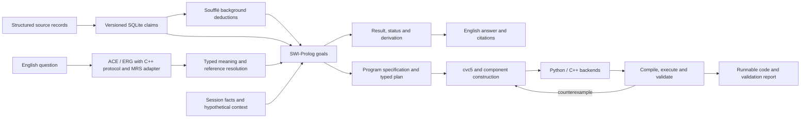

# unllm upgrade plan

Record experiment designs, variables, results and decisions in the [central experiment log](EXPERIMENT_LOG.md).

Status updated 2026-11-18. The [C++ migration](CPP_MIGRATION_PROGRESS.md) completed its native deployment and 33 baseline checks. The [numeric pilot](../archive/symbolic_distillation/numeric_change/README.md) stopped before rule acquisition. Five of six discovery requests reached the parser reading limit. The [algorithm representation](../experiments/algorithm_ir/README.md) and [first construction evaluation](../experiments/algorithm_ir/SYNTHESIS.md) run from supplied specifications. Stage 13b [parser repeatability](../archive/interpretation_diagnostics/README.md) passed its development gate. The typed GUI requirements graph passed its [development gate](SYMBOLIC_INTERPRETATION_PLAN.md#2-introduce-an-explicit-typed-requirements-graph). The [role-binding trial](../archive/interpretation_diagnostics/role_trial/README.md) identified coordinated numeric attachment as the next diagnostic while the [external corpus deployment](../experiments/corpus_storage/s0/MIGRATION.md) enters observation. Independent blind release evaluation remains open.

The work lives in /home/whisper/repo-work/unllm-upgrade. The original unllm directory and ActivityScope's vendored copy remain outside this change. The upgrade copy preserves the current local edits and Git history, has its own regenerated build, and passes the six existing CTest suites.

The objective is a useful symbolic answer path that composes facts and rules, explains its conclusions, and revises them when premises change. The completed upgrade must also synthesize useful Python and C++ programs of roughly 100 meaningful source lines within the supported task families. Reasoning, premise acceptance, answer composition and program synthesis use explicit code and data. Generative models do not rewrite questions, invent premises, perform inference, write answers or generate programs on this path.

**Architecture decisions**

The remaining capability work is connected in the [coding capability roadmap](CODING_CAPABILITY_ROADMAP.md):
native migration, targeted semantic distillation, interpretation reliability,
general algorithm representation, bounded algorithm synthesis, reusable coding
knowledge, and integrated workflows/performance. The migration preserves current
capabilities; the algorithm milestones address the larger coding-tool objective.

The [native migration plan](CPP_RUNTIME_MIGRATION_PLAN.md) supersedes earlier
Python-worker and Python-AST implementation choices. First-party host logic and
product commands must be C++; Python remains an output language and optional
target execution environment. The rows below describe the required destination;
the currently implemented runtime still uses Python until migration passes.

| Component | Responsibility |
| --- | --- |
| SQLite fact store | Authoritative, versioned source claims, entity identities, aliases, relation definitions, qualifiers and source references. |
| Soufflé | Derive reusable relations over a fixed knowledge snapshot: declared transitive relations, taxonomy and other finite background joins. Generate a C++ module and run it during knowledge preparation or a bounded snapshot rebuild. |
| SWI-Prolog | Answer goals over the prepared snapshot and session facts; compose relations; evaluate conditions; track unresolved premises; handle supported hypothetical contexts. Embed through its C++ API and use tabling where appropriate. |
| ACE with the English Resource Grammar | Analyze English into semantic structures. A C++ adapter supervises native ACE and decodes its structured protocol/MRS using native parsers. PyDelphin remains migration-reference tooling only. |
| cvc5 with syntax-guided synthesis (SyGuS) | Solve bounded synthesis problems over an explicit grammar and specification. Supply expressions, conditions and other supported subprograms to the program-construction layer through its existing API. |
| C++ typed program representation and language backends | Compose contracted components and synthesized subprograms, structurally emit either output language without a Python host dependency, and retain the specification and construction trace. |
| C++ job controller and target toolchains | Compile or execute generated candidates, run independent checks and supply counterexamples. Python is invoked only to execute/validate requested Python output. |
| ANTLR and Qt application components | Parse bounded arithmetic with one grammar in both languages; construct stateful desktop windows, controls and event bindings from a typed application representation. |
| Existing unllm components | Retrieve source material, perform supported calculations and conversions, manage the CLI, and realize structured answers in English. |

Soufflé and Prolog have distinct rule ownership. Background relation rules live in Soufflé; interactive and session rules live in Prolog. A relation has one authoritative definition. Derived Soufflé results enter Prolog as versioned evidence with a path back to their premises. Prolog conclusions do not feed back into the same background build as new source facts.

Materialize selected useful relations within declared knowledge modules and tuple/memory limits. Do not compute every possible transitive closure across the entire corpus by default. Account for the size and cost of the derived relations in the benchmarks.

Z3 and Grammatical Framework remain deferred. cvc5 is added as a specialist for the newly required synthesis capability; SWI-Prolog and Soufflé remain the main reasoning combination. cvc5 synthesizes terms within supplied grammars and constraints, not unrestricted Python or C++ directly. The typed construction layer, language backends and validation tools are required parts of the implementation.

**Language and grounding**

ACE/ERG is the selected parser to evaluate first. Its output describes sentence meaning; it does not automatically identify real-world entities, select the intended word sense, resolve conversation references or supply world knowledge.

The semantic bridge preserves predicates, arguments, variable bindings, conjunction, negation, quantifier scope, tense and relevant modifiers. It maps supported structures into a typed question or assertion. It never discards a qualifier merely to make a question executable.

Entity resolution uses canonical identifiers, documented aliases, relation argument types and conversation context. Search and embeddings can propose candidates; similarity does not establish identity or prove a claim. If two supported interpretations would give different answers, ask for clarification. Bound the number of interpretations explored and report incompleteness when the bound matters.

Domain vocabulary and relation mappings are explicit data. They attach words and grammatical structures to concepts, rather than associating complete question strings with answers. New names and new compositions of supported relations must work without adding question-specific branches.

The reference evaluation disables learned parse selection and learned retrieval components. Optional existing statistical retrieval or parse ranking must be separately identified and measured; neither supplies logical premises or certifies conclusions. Verify the parser configuration in the feasibility stage before making a claim that a run used no learned components. The symbolic answer path makes no generative-model calls.

If the parser cannot meet the coverage and latency gates, stop expansion of the ontology and revisit the language front end. A collection of phrase-specific regex fallbacks is not the recovery plan.

**Facts, rules and evidence**

Use a separate SQLite store beside the upgrade's generated state. Existing packs are inputs opened read-only. Initial inputs are normalized structured property records, selected existing infobox fields with documented adapters, and explicitly supplied session facts. Structured Wikimedia claims are a possible additional importer; a new large download is not a prerequisite.

Each accepted claim carries:

- A stable claim identifier and typed predicate arguments, including entity IDs or typed quantities.
- Positive or explicit negative evidence.
- Relevant validity interval and qualifiers; timeless claims must be identified as such.
- Origin: source assertion, session assertion or hypothetical assumption.
- Stable source location: pack and version, document, property row or passage/span.

Keep alternative and conflicting source claims. An infobox value is raw text until an adapter has parsed and validated it. The first release imports structured records and supported session assertions; it does not attempt unrestricted claim extraction from arbitrary paragraphs. Retrieved prose remains available as cited reference material.

Relation definitions declare argument types, inverse relations, whether transitivity is valid, applicable temporal semantics and whether a set is complete. Do not assume that every relation resembling containment is transitive. Do not promote common tendencies to universal rules.

For the initial shared logical fragment, use finite, typed relations and range-restricted rules. Prolog adds bounded goal search and trusted calculation predicates. Negation by absence is allowed only for explicitly complete relations and contexts. Universal claims, exact counts and exhaustive lists also require a justified completeness boundary.

Track positive and negative support separately. A proposition may have positive support, negative support, both, or neither. Contradictory evidence does not make unrelated conclusions true. Query execution separately reports complete, ambiguous, unsupported or resource-limited status. A timed-out search is not a negative answer.

Every derived claim has a derivation linking rule IDs, rule versions, variable bindings and supporting claim IDs. Use Soufflé's provenance capability behind an adapter and record Prolog rule witnesses explicitly. A Prolog success alone is not a user-facing explanation. Source claims and derivation steps must remain distinguishable. Preserve any unresolved source conflicts in the explanation.

Reconstruct a bounded, acyclic explanation from the evidence graph and check it against the permitted rule fragment before presentation. Avoid putting unbounded full proof trees in tabled answers. Cycles and multiple derivations must not create infinite explanations.

**Initial user-visible capabilities**

1. Follow several supported relations across documents: for example, identify a work's author, that person's birthplace, and the country containing the birthplace under the relevant temporal assumptions.
2. Answer conjunctions, declared inverse and transitive relations, supported comparisons, and exact or partial lists with their completeness stated.
3. Explain a conclusion through its actual premises and rules. State which premises are missing for a bounded candidate derivation; do not claim to enumerate every possible explanation.
4. Carry entities, quantities, assumptions and goals into follow-up questions. Resolve a correction to the intended premise and recompute dependent answers.
5. Evaluate supported hypothetical changes in a separate context and compare the results.
6. Turn supported programming requests into runnable Python or C++ utilities around 100 meaningful lines, with declared inputs, outputs, assumptions, run instructions and validation results.

Exercise these capabilities first with two fact modules: factual relations from local reference records, and requirements/availability records. These are initial data modules for the same machinery. Success must include unfamiliar entities and relation chains in both.

Scientific causal explanations, unrestricted planning, automatic discovery of reliable rules from arbitrary prose, and unlimited commonsense reasoning are outside the first release. A logical dependency explanation must not be presented as an established physical cause.

**Program synthesis: Python and C++**

This is a required release milestone. Factual reasoning alone does not complete the upgrade. Start with standalone functions and command-line utilities for record validation and aggregation, filtering/grouping/deduplication/sorting, and bounded numeric or text transformations. Include tasks requiring multiple functions, branches, loops, file or standard-stream input, and meaningful error handling.

Target the locally pinned Python 3 interpreter and C++20, using standard-library facilities first. State any additional dependency explicitly. More output languages, application frameworks, network services and unrestricted modification of arbitrary existing repositories are later work.

Roughly 100 lines describes useful program capacity, not a line-count objective. Select tasks that naturally justify that size; measure nonblank, noncomment lines and program structure. Do not inflate output with padding, copied tests or repeated statements, and do not reject a sound shorter implementation merely for being concise.

Use the following construction and validation process:

1. Convert the request into a typed specification: input/output schemas, required transformations, edge cases, invariants, error behavior and allowed effects. Accept examples and constraints as additional evidence. Use documented defaults for routine details; clarify an ambiguity when it changes the required behavior. Preserve the interpreted specification alongside the original request.
2. Let Prolog decompose the specification into smaller obligations and choose compatible components from a versioned catalog. Soufflé may precompute component compatibility and dependency relations. Components describe operations and contracts; they are not stored complete answers to particular prompts.
3. Build a typed intermediate program with functions, control flow and supported collection operations. Use cvc5 SyGuS to solve bounded unknown expressions, guards and subprograms, and check the corresponding formal obligations where they can be represented. Compose the resulting pieces using their contracts. Do not attempt an unconstrained statement-by-statement search over an arbitrary 100-line source file.
4. Implement both structural emitters in C++, including Python indentation, precedence and escaping. Format C++ with clang-format and parse/type-check/compile it with Clang. Modify the intermediate representation and regenerate source during repair; do not patch source with question-specific regex replacements or invoke Python AST code to implement emission.
5. Run supplied examples, independent acceptance tests and deterministic native property cases against emitted programs. Preserve the existing Hypothesis-derived counterexamples as fixtures; old Python suites remain development references during migration. Use C++ address/undefined-behavior sanitizers, and compare both backends with independent reference semantics. Feed specification-derived counterexamples into bounded repair. Held-out acceptance cases are reserved for scoring, not repair.

Give the shared representation explicit semantics for numeric ranges, overflow, strings/encoding, ordering, rounding, errors and file effects. Where Python and C++ differ, enforce the declared contract or narrow the supported domain. A specification satisfied by an abstract solver term does not automatically establish that its emitted Python or C++ implementation satisfies it.

Use separate resource-limited job workspaces for candidate execution, with fixture inputs, no network and no writable access to the source repositories or installed reference packs. Keep this worker separate from the normal question-answering loop.

Return the source file, language/toolchain version, build/run instructions, specification assumptions and validation summary. Record construction choices, compiler diagnostics, tests run and formal checks/bounds in the job report. Distinguish a candidate, a program validated by tests and a result verified for a stated formal fragment; compilation or a passing finite test set alone is not an unrestricted correctness proof. If no candidate meets the contract within budget, report an incomplete synthesis job.

The final gate includes fresh requests and a requirement change to previously generated code, followed by regeneration and revalidation. Reusing normal library components is expected; retrieving an unchanged canned program or generating a padded demonstration does not establish the synthesis capability.

**Conversation and changing knowledge**

The fact snapshot is shared and read-only during a query. Session assertions and hypothetical assumptions belong to an explicit session/context and revision. Tables and caches include those identities so results cannot leak between chats or scenarios.

A correction can retract a user's earlier session assertion. A disagreement with a reference source creates a separate claim or scenario; it does not silently rewrite the source. Generated answer text never becomes a new authoritative premise.

Use Prolog's declared incremental dependencies for applicable session changes. Changes to external SQLite data still require explicit synchronization or a new snapshot; tabling does not observe arbitrary external writes automatically.

If a hypothetical alters facts used by a Soufflé-derived relation, its cached conclusions cannot be reused unchanged. Rebuild the affected background module in a separate bounded instance for that context. If that cannot finish within the request budget, return an incomplete or unsupported result.

Publish background rebuilds atomically, keyed by input hashes, schema version and rule versions. Keep in-flight queries on their original snapshot; switch new queries to the new one. Do not rely on ordinary Soufflé execution to retract stale results incrementally.

**Integration with the current code**

The current Reading type describes routing and selected language features, not a general logical meaning. Add dedicated meaning, fact, goal and derivation types. Preserve the existing Analyzer API for legacy consumers instead of stuffing the new semantics into its string fields.

Session::ask currently rewrites follow-ups through LocalModel before the calculator is reached. The symbolic path resolves follow-ups from structured context and routes unambiguous direct calculations early. It never calls LocalModel::rewrite or LocalModel::ask.

World currently combines retrieval and answering, and a ready reranker changes which layers run. Expose retrieval as an independent source-evidence service. Route a supported symbolic goal explicitly; its selection must not depend on whether a reranker happens to be loaded.

Extend result and conversation structures to carry answer origin, truth support, execution status, context and derivation handles. Do not reuse a retrieval score as logical confidence. Render conclusions using the existing grammatical realization facilities, extended to the typed relations and explanation structures.

When a question is unsupported or the premises are insufficient, the symbolic mode may return clearly identified source excerpts or a missing-information response. It does not silently invoke a generative fallback or present a nearby passage as a proved answer.

Route supported code requests to an explicit synthesis job, retaining the specification and program representation in conversation state so a follow-up can change requirements. Return job progress and code artifacts separately from factual answers. The interactive answer deadline does not silently terminate a valid longer synthesis job.

Provide legacy, shadow and symbolic development modes. Shadow mode records the symbolic interpretation and result while retaining legacy output for comparison. Promote symbolic mode to the upgrade's default only after its gates pass. The original executable is not replaced.

Give the upgrade its own resident-service socket, log, session namespace, derived-state directory and reports. The current default socket is shared across binaries, so merely running the copied executable can connect to the original service. CLI comparisons must set or generate an upgrade-specific UNLLM_SOCKET and identify the serving build. Installed source packs may be shared read-only.

**Implementation order and completion gates**

| Stage | Work | Complete when |
| --- | --- | --- |
| 1. Baseline and isolation | Separate runtime state; freeze source snapshots and development/validation sets, including programming tasks; capture the original pipeline and its model-disabled baseline. | Each report identifies the binary, serving process, source versions, settings and timing. Queries cannot be served by the other directory's process. |
| 2. Feasibility slice | Pin and install local dependencies; embed Prolog; generate and call one Soufflé module; keep ACE/PyDelphin resident; translate annotated language cases. Exercise cvc5 on a small specification and emit/run the resulting function in both Python and C++. | An English question traverses both reasoning engines and returns a source-backed derivation. The small synthesized function passes independent checks in both languages. Measure language coverage and bounded synthesis before expanding the knowledge base. |
| 3. Knowledge and provenance | Add the fact schema, property adapters, initial modules, snapshot publication and proof adapters. | Every accepted and derived claim has inspectable provenance; repeated builds are reproducible; conflicting and incomplete data retain their status. |
| 4. Reasoning and conversation | Add compositional goals, comparisons, bounded missing-premise analysis, corrections and hypothetical contexts. | Unseen names, deeper chains, cycles, alternate proofs, retractions and simultaneous sessions pass the logical and dialogue checks. |
| 5. Product path | Connect source retrieval and structured realization, add modes and diagnostics, and remove generative calls from the symbolic route. | CLI conversations work end to end with no generative service present; unsupported questions have honest outcomes; all six existing suites still pass. |
| 6. Python/C++ program construction | Add the typed specification/program representations, component contracts, Prolog decomposition, cvc5 synthesis and both language backends. | Supported requests generate real multi-function utilities around 100 meaningful lines in each language, using composed operations and synthesized decisions. New task compositions work without adding whole-program answer templates. |
| 7. Execution, validation and repair | Add isolated job execution, independent/property checks, C++ sanitizer runs, bounded counterexample-guided repair and code-revision conversations. | Programs compile or parse, execute correctly on independent cases, and survive a changed requirement after regeneration. Report tested behavior and formal bounds accurately; unsuccessful jobs remain unsuccessful. |
| 8. Quality and performance | Compare modes on frozen reasoning and synthesis tasks, inspect new conversations, profile bottlenecks and optimize measured costs. | Meet the factual-reasoning and code-generation release gates below; publish completion rates, timing, results and remaining limitations for both languages. |
| 9. Stateful calculator applications | Extend the representation with typed state, functions, exception handling, widgets and events; add recursive Prolog capability planning, Soufflé wiring checks, an ANTLR arithmetic grammar, cvc5 state rules and Qt backends. | Generate standard and revised calculators in Python and C++; real mouse/keyboard interaction, independent arithmetic checks, error recovery, optional memory, feature exclusions and C++ sanitizer execution pass. |
| 10. Shared behaviour-contract construction | Remove application-family dispatch from the new specification and constructor. Plan typed primitive requirements, synthesize simultaneous scalar updates from relational postconditions and lower mixed state/UI/file behaviour through shared backends. | New labels, coefficients and compositions work without generator edits; renaming a program leaves its plan and handler graph unchanged; coupled updates, revisions, fresh GUI/file inputs and both language backends pass. |
| 11. Repair request grounding and practical behavior | Replace word-trigger interpretation with linked ERG frames and typed roles; remove early calculator routing; add flat records/persistence, monotonic clocks/events and variable percentages; plan effects from prerequisite goals; fix numeric typing and nested CLI transport. | All six original manual-trial questions work unchanged in both languages and pass independent keyboard/mouse/file/timer workflows; new compositions pass; the full CLI and original regression suites pass. Report vocabulary, solver, state and evaluation bounds. |
| 12. C++ implementation migration (complete) | Port host interpretation, state/store/proof/answer logic, construction, emitters, validation and product maintenance; replace the Python worker with a compiled worker. | Meet M0–M7, compatibility and no-Python deployment gates in [the full migration plan](CPP_RUNTIME_MIGRATION_PLAN.md). Native host and deployment verified. |
| 13a. Targeted symbolic distillation (feasibility evaluated) | Use the native representations to check feasibility and acquire verified numeric-change clauses; compare unchanged, engineering-only and distilled-rule versions. | Meet the bounded acceptance, contribution, six-output and regression gates in [the reviewed pilot design](TARGETED_SYMBOLIC_DISTILLATION.md). Stopped before teacher selection or rule acquisition. |
| 13b. Broader symbolic interpretation reliability (milestones 1 and 2 verified on development cases) | Establish wider parser consistency/traces, a general typed requirements graph, role binding, scoped exclusions and targeted clarification. | Meet the broader gates in [the reference roadmap](SYMBOLIC_INTERPRETATION_PLAN.md), after migration and pilot assessment. |
| 14. Typed algorithm representation (bounded representation implemented) | Add native functions, locals, sequences, branches and bounded iteration with explicit semantics. | Several distinct manually specified algorithms execute equivalently in Python/C++; representation checks are not counted as synthesis. See [the capability roadmap](CODING_CAPABILITY_ROADMAP.md). |
| 15. Bounded algorithm construction (first development evaluation complete) | Search and refine typed algorithm structures using contracts, independent examples and counterexamples. | At least 8/12 frozen supported tasks pass both languages across three computation classes; six annotated stop cases handled; no task-specific patches or wrongly validated completions. |
| 16. Reusable coding-knowledge distillation (conditional) | Acquire verified helpers/decomposition rules offline after numeric acquisition and algorithm-engine evidence. | Package ablation shows transfer across at least three structurally distinct fresh tasks; no runtime teacher or validation bypass. |
| 17. Integrated coding workflows and performance (later) | Connect English, clarification, construction, execution and revision; optimize measured bottlenecks. | Independent end-to-end workflows preserve requirements and report interpretation, synthesis, validation and latency separately. |

Stage 9 is implemented. Four calculator specifications pass in both languages, with fresh GUI checks after construction and a creation/revision/language-switch conversation. At that milestone all ten CTest suites passed, including the six original suites. This extended the supported application catalog; arbitrary application generation and an independently blinded release claim remained outside that development milestone.

Stage 10 is implemented and supersedes application-family expansion as the strategy for new stateful programs. Five compositions pass in both languages, including one selected at run time. At that milestone all eleven CTest suites passed, with 53 Python tests across the five upgrade suites.

Stage 11 is implemented. The unchanged six-request fixture generates twelve outputs that pass independent workflows; five follow-up combinations also pass. All twelve CTest suites pass, with 64 Python tests across the six upgrade suites. [The repair report](REQUEST_REPAIR.md) records the actual results, including failures found and repaired during development. The independent blind release gate remains open; arbitrary algorithm discovery is not claimed.

The historical local-model comparison scored 20/32 for the resident grammar. Cross-history reproducibility in the native host is the first Stage 13b gate. The broader interpretation and end-to-end targets remain open.

Dependency installation and integration are now implemented locally in the upgrade copy. `tools/setup_upgrade.py` verifies pinned archives and installs SWI-Prolog, Soufflé, ACE/ERG, PyDelphin, cvc5 and Hypothesis without a root install. See `dependencies-upgrade.lock.json`, `requirements-upgrade.txt` and [the upgrade guide](UPGRADE.md).

**Evaluation and performance gates**

Keep the existing six suites as regression checks. Add independent reasoning cases, manually annotated meaning cases and full conversations, scored on typed answers and validated derivations. Answer-pattern matches alone cannot establish correct reasoning.

Use generated fact graphs with unseen names and topology to test generalization, plus frozen natural paraphrases. Include explicit false facts, missing facts, incompatible qualifiers, ambiguous references, cycles, duplicate proofs, corrected premises, changed source versions and cross-session isolation.

Freeze development and validation splits before implementation. Preserve the existing sealed-exam rule in tests/clean/README.md: never inspect held-out questions or individual failures during development; report aggregate results only. Existing answer-matching regexes are evaluation machinery, not the runtime reasoning design.

Compare three user-visible configurations: the current full pipeline, a matched configuration with generative answering disabled, and the symbolic upgrade. Separately measure Prolog alone against the combined Prolog/Soufflé arrangement on the same supported background tasks, including preprocessing and memory costs.

Promotion requires:

- All existing regression suites and deterministic logic/proof checks pass.
- At least 90% exact end-to-end correctness on the frozen supported-reasoning validation set; unsupported and timed-out items count against this score. Answered precision is at least 95%. Publish coverage, false assertions and clarification rates separately.
- No correctness regression in the frozen direct calculation and factual-lookup cases the upgrade claims to support. Report broader encyclopedia performance separately, including topics the new path does not yet cover.
- Demonstrated correction and hypothetical isolation, including when background materialization would otherwise be stale.
- Successful manual conversations using fresh prompts, with evidence inspected beyond the built-in tests.
- Passing the required Python/C++ synthesis gate below. Completing factual reasoning without working code generation does not satisfy the upgrade.

Freeze at least ten supported utility specifications spanning at least three task families, and attempt every specification in both languages. Require at least 80% successful end-to-end completion in each language separately, with every program reported as validated passing all independent acceptance checks. Timeouts, unsupported requests and failed candidates count against completion. Include at least three substantive demonstrations per language whose natural readable implementations are around 100 lines, plus a requirement-change/regeneration check. Report source size, structural complexity and component reuse so superficial padding or hidden complete solutions cannot satisfy the milestone.

Assess the interpreted specification against the original programming request separately from whether the generated code implements it. Keep evaluation inputs and reference implementations independent of candidate construction. Differential checks between Python and C++ supplement the independent oracle; agreement between two faulty backends alone is not success.

Initial performance targets are p95 below 100 ms for core reasoning on a declared 100,000-input-fact benchmark, and p95 below 1 second warm for common supported short questions over the prepared store. These are acceptance targets, not measured predictions. A normal interactive request has an initial 3-second total budget with an explicit incomplete outcome when exhausted; larger batch workloads use separate budgets.

Program synthesis uses a separate job budget, initially up to 180 seconds per program including construction, compilation, execution and repair. Time-limit each child process within that total. Report first-candidate time, validated-result time, solver time, iteration count and resource use separately for Python and C++; do not apply the 1-second factual-answer target to synthesis. Raise a budget only through a separately identified configuration, and count timeouts in the configured benchmark.

Record cold start, warm p50/p95, parser time, entity resolution, retrieval, each engine, explanation generation, memory and offline preparation separately. Keep engines resident and load components lazily. Perform reusable Soufflé derivations outside the ordinary answer path. Cache with source, rule and context versions. Do not invoke every subsystem for every question.

**Planned code locations**

| Area | Intended change |
| --- | --- |
| CMakeLists.txt | Optional symbolic build support, SWI-Prolog linkage, Soufflé generation and additional checks. |
| include/unllm/ and src/ | New typed meaning/fact/goal/result interfaces, store and engine adapters, evidence and realization support. |
| reasoning/prolog/ and reasoning/souffle/ | Explicit versioned rule modules with distinct ownership. |
| tools/unllm_symbolic_worker.cpp and native semantic modules | Compiled worker, persistent ACE client and structured MRS parsing. |
| Native facts/import/update tool targets | Structured-source normalization, background preparation and product maintenance without Python host helpers. |
| include/unllm/synthesis/ and src/synthesis/ | Native typed program/specification definitions, contracted components, cvc5 integration and both structural emitters. |
| Native job controller and generated job directories | Resource-limited compilation/execution, native property checks, bounded repair and source/validation artifacts. Python is a target execution dependency only. |
| tools/unllm_main.cpp | Runtime isolation, mode selection, structured conversation state and symbolic routing. |
| include/unllm/knowledge.h and src/answer.cpp | Retrieval/answer separation and explicit answer provenance. |
| tests/ and evaluation tooling | Meaning, reasoning, proof, conversation, isolation, program synthesis, backend semantics and performance validation. Preserve pre-existing local edits. |

The implementation now covers the initial bounded reasoning and Python/C++ utility families, including the CLI, source adapters, native provenance, executable validation and repair. [The implementation report](UPGRADE_REPORT.md) records actual checks, measurements and limits. Development scores are not a substitute for the separately frozen blind evaluation proposed above; that external release gate remains unproven. Comparisons currently cover explicit height facts, counts remain non-exhaustive, and arbitrary qualified/historical statements remain unsupported.

**Primary references**

- [SWI-Prolog C++ interface](https://www.swi-prolog.org/pldoc/man?section=cpp2) and [incremental tabling](https://www.swi-prolog.org/pldoc/man?section=tabling-incremental).
- [Soufflé C++ interface](https://souffle-lang.github.io/interface), [Datalog tutorial](https://souffle-lang.github.io/tutorial) and [provenance](https://souffle-lang.github.io/provenance).
- [ERG semantic representations and their scope](https://delph-in.github.io/docs/erg/ErgSemantics_Essence/) and [ACE options](https://delph-in.github.io/docs/tools/AceOptions/).
- [PyDelphin ACE process integration](https://pydelphin.readthedocs.io/en/latest/api/delphin.ace.html) and [MRS JSON codec](https://pydelphin.readthedocs.io/en/latest/api/delphin.codecs.mrsjson.html).
- [Wikidata structured data model](https://www.wikidata.org/wiki/Wikidata:Data_model).
- [cvc5 syntax-guided synthesis example and grammar API](https://cvc5.github.io/docs/latest/examples/sygus-fun.html) and [Python/C++ API relationship](https://cvc5.github.io/docs/latest/api/python/python.html).
- [Python AST construction and source emission](https://docs.python.org/3/library/ast.html), [Clang toolchain](https://clang.llvm.org/docs/UsersManual.html) and [Hypothesis property checks](https://hypothesis.readthedocs.io/en/latest/).
- [Clang AddressSanitizer](https://clang.llvm.org/docs/AddressSanitizer.html) and [UndefinedBehaviorSanitizer](https://clang.llvm.org/docs/UndefinedBehaviorSanitizer.html).
